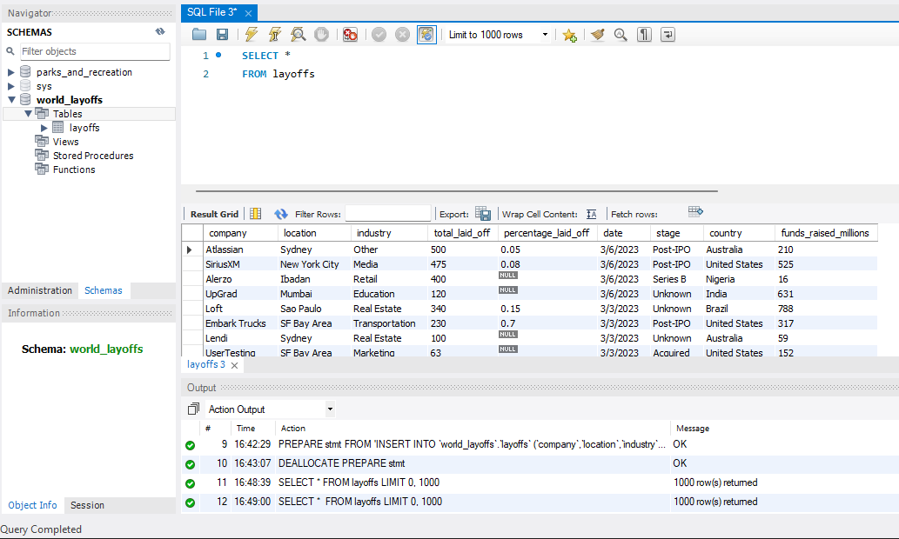
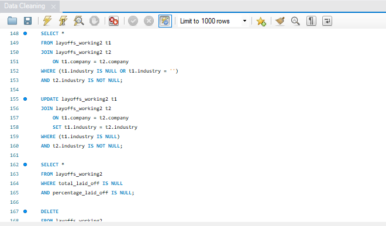
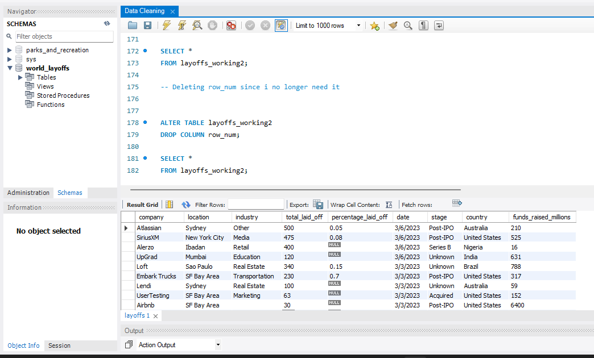

# World Layoffs: Data Cleaning (MySQL)

Raw data is rarely analysis-ready. This project cleans a global tech layoffs dataset in MySQL so it can be analyzed reliably.

➡️ The cleaned table is analyzed in the companion project: [World Layoffs: Exploratory Analysis](https://github.com/Stormhold123/Exploratory-Analysis-MySQL-)

## The Problem
The raw dataset (2,361 rows) contained duplicate records, inconsistent industry and country labels, text-formatted dates, blank and NULL values, and rows with no layoff information at all.

## Raw Data

## Cleaning Steps

1. **Protected the raw data**: created `layoffs_working` as a copy so the original `layoffs` table stays untouched
2. **Removed duplicates**: used `ROW_NUMBER()` with `PARTITION BY` across the key columns inside a CTE to find duplicate rows (5 found), then loaded the results into `layoffs_working2` and deleted rows where `row_num > 1`
3. **Standardized the data**
   - Trimmed whitespace from `company`
   - Merged industry variants (`Crypto`, `CryptoCurrency`, `Crypto Currency`) into one `Crypto` label
   - Fixed `United States.` to `United States` using `TRIM(TRAILING '.')`
4. **Fixed the date column**: converted text dates to a real `DATE` type with `STR_TO_DATE` and `ALTER TABLE ... MODIFY COLUMN`
5. **Handled NULLs and blanks**
   - Converted blank industries to NULL
   - Filled missing industries with a self join on `company` (e.g. Airbnb, where another row for the same company had the industry)
   - Deleted rows where both `total_laid_off` and `percentage_laid_off` were NULL, since they carry no usable information
6. **Dropped the helper column**: removed `row_num` once duplicates were handled

## Result
- 2,361 raw rows reduced to about 2,000 clean rows
- Consistent industry and country labels
- Dates stored as a proper `DATE` type
- A clean table, `layoffs_working2`, ready for analysis

## Files
- [`Data_Cleaning.sql`](Data_Cleaning.sql): full cleaning script
- [`layoffs.csv`](layoffs.csv): raw dataset

## Skills Demonstrated
CTEs · Window functions (`ROW_NUMBER`) · Self joins · String functions (`TRIM`, `STR_TO_DATE`) · `UPDATE`, `DELETE`, `ALTER TABLE` · Data standardization · NULL handling

## Tools
MySQL · MySQL Workbench
